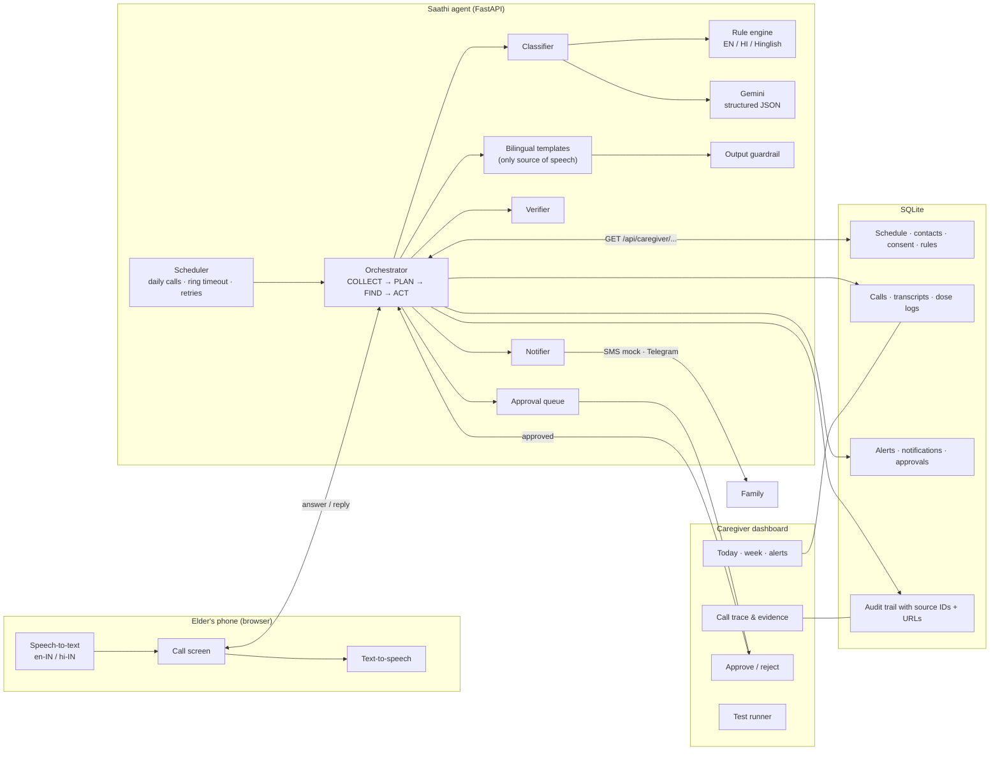
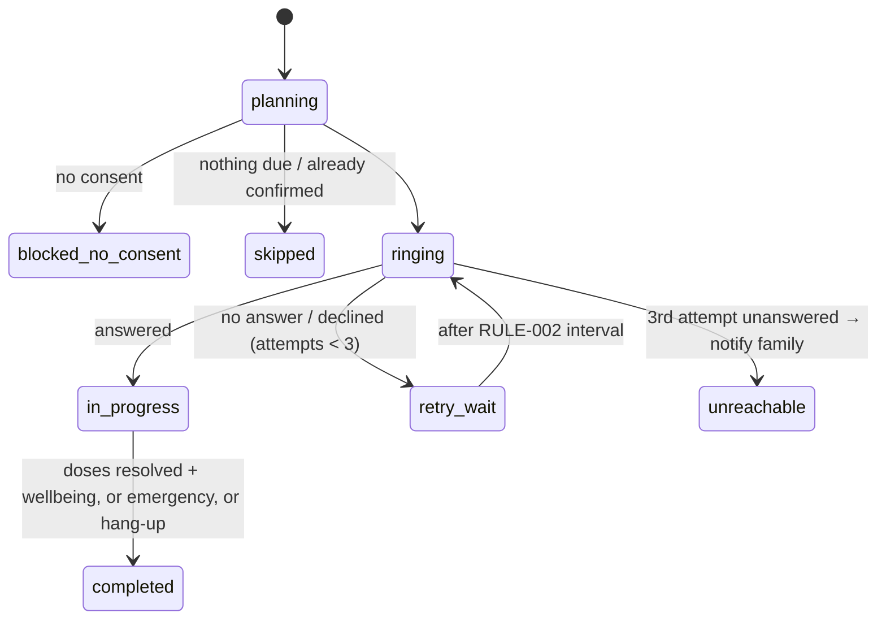

# Saathi — Agent Architecture, Solution and Tools

## Problem

About half of medicines for chronic disease are not taken as prescribed (figure from the problem statement). Elders on several daily medicines forget whether they took a dose, or take it twice. Families try to cover this with daily phone calls, which are stressful for everyone and leave no record anyone can review.

## Solution in one line

An agent that makes a short daily voice check-in call, turns the answer into verified dose records, and escalates to the family when something is wrong. It never gives medical advice and never takes an irreversible action without a human's approval.

## System diagram

## The agent loop

The four stages from the brief run on every call, and stages 2–4 run again on every reply.

| Stage | What happens | Records cited |
|---|---|---|
| **COLLECT** | Load active medicine schedule, family contacts and consent through the caregiver API | `MED-*`, `FAM-*`, `CON-*` |
| **PLAN** | No consent → don't call. Work out which doses are due. Plan: greet → confirm each dose → wellbeing → log/notify → verify. On each reply, classify it and decide the actions. | `CON-*`, call turn `TN-*` |
| **FIND** | Read the last 7 days of dose logs and the care rules; count consecutive missed slots (2+ raises the severity); look up the rule for each escalation | `DL-*`, `RULE-001…008` |
| **ACT** | Ring, retry, log doses, create alerts, notify family, queue approvals | `DL-*`, `AL-*`, `NT-*`, `AP-*` |
| **VERIFY** | Re-read each dose log (target date, slot, status, source session), each notification, each schedule change, and that every due dose has a record when the call ends | PASS/FAIL in trace |
| **GUARDRAIL** | Block medical advice on input; scan every spoken line for dosing advice before it is said | trace |

### Call state machine

### Conversation logic (per reply)

1. **Emergency** (chest pain, breathing trouble, fainting, a fall, stroke signs, bleeding, overdose) → tell them to call 112, send a critical alert to *all* family contacts, end the call.
2. **Dose status** for each pending medicine: taken / missed / unclear. Missed → alert (high after 2 consecutive misses) and a reminder not to take extra without asking the doctor.
3. **Double dose** reported → high alert; asked not to take more until they've spoken to the doctor.
4. **Symptoms** → advise rest and the doctor, high alert, family notified, doctor report queued for approval.
5. **Advice request** → decline, refer to the doctor, alert family, carry on with the check-in.
6. **Prescription change** mentioned → schedule change queued for approval; the agent changes nothing itself.
7. **Unclear** → ask once more about the specific medicine; still unclear → log *unconfirmed* and flag it.
8. All doses resolved → one wellbeing question (skipped if a concern was already raised) → close.

## Understanding: hybrid by design

| | Rule engine | Gemini |
|---|---|---|
| Runs | Always | When `GEMINI_API_KEY` is set |
| Strengths | Deterministic, instant, offline, auditable | Nuance, mixed English/Hindi, typos, speech-recognition errors, translation |
| Dose status | Used when Gemini is off, fails or has confidence < 0.6 | Used when confidence ≥ 0.6 |
| Safety flags | **Union** of both: the LLM can add a flag but never remove one | |
| Speech | Neither. All speech comes from templates | |

The trace records which engine decided and shows both views when Gemini was used.

## Approval policy

| Action | Undoable? | Policy |
|---|---|---|
| Log a dose status | Yes (caregiver can correct) | Automatic, then verified |
| Create alert / notify family | Yes, and it's the point of the product | Automatic, then verified |
| Change the medicine schedule | No | **Needs caregiver approval** (RULE-007) |
| Send a health report to the doctor | No (disclosure) | **Needs caregiver approval** (RULE-007) |

## Data model (SQLite)

`patients`, `medications`, `family_contacts`, `consents`, `care_rules` hold the inputs. `call_sessions`, `call_turns` and `dose_logs` hold what happened. `alerts`, `notifications` and `approvals` hold the actions. `audit_log` holds the evidence. `test_runs` holds the proof. Every record has a stable readable ID, and the dashboard links each ID in a trace to the API URL where it can be inspected.

## Tools

- **Python 3.12 + FastAPI**: agent runtime and REST API
- **SQLite**: data store with an audit trail
- **Google Gemini API**: understanding, transcript correction, translation, call summaries (REST, JSON schema output)
- **Web Speech API**: speech-to-text (`en-IN`, `hi-IN`) and text-to-speech in the browser
- **Vanilla HTML/CSS/JS**: caregiver dashboard and elder phone
- **Telegram Bot API** (optional): real family alerts
- **pytest + Playwright**: automated scenarios and UI checks
- **Render**: hosting (free tier)

## What production would add

A real phone line (e.g. Exotel or Twilio voice with streaming STT), call times measured in minutes rather than seconds, authenticated caregiver accounts, encrypted storage, and an EHR/pharmacy integration for schedules. None of these change the agent's structure: the telephony layer replaces the browser phone and calls the same `answer`/`reply`/`hangup` endpoints.
